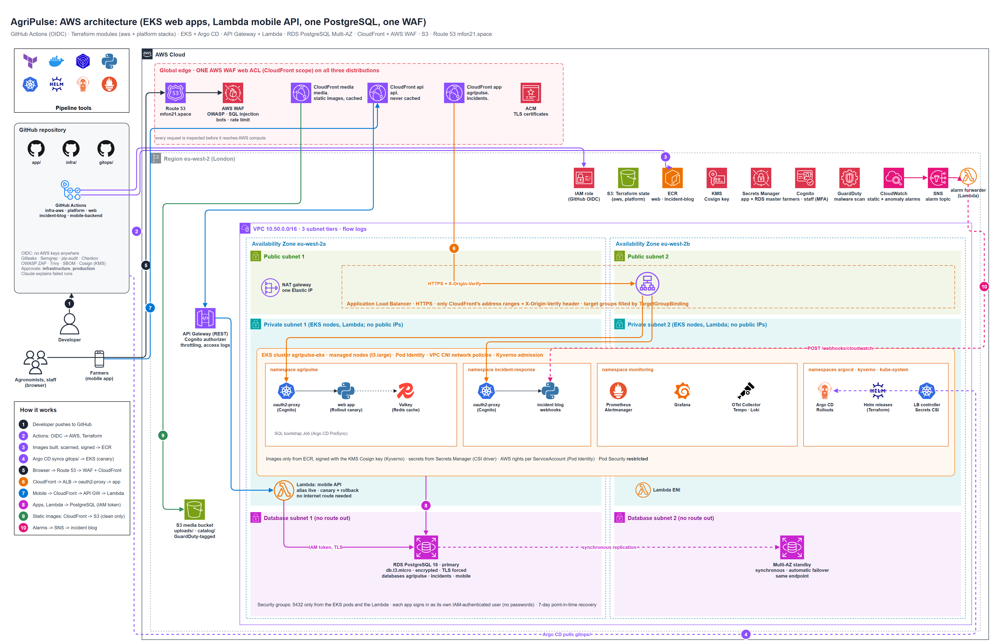

# AgriPulse: AgriTech on AWS (EKS + Lambda + RDS PostgreSQL)

| Part | Runs on | Code |
|---|---|---|
| Web app for agronomists (farms, harvests, market prices), Redis cache-aside | **EKS** (Argo Rollouts canary, oauth2-proxy with Cognito), Valkey cache in the cluster | `app/web`, `gitops/charts/agripulse-web` |
| Incident-response blog (NIST lifecycle, MTTA/MTTR, alert webhooks) | **EKS** | `app/incident-blog`, `gitops/charts/incident-blog` |
| Mobile API for farmers (fields, observations, photo uploads) | **API Gateway + Lambda** (Cognito authorizer, alias canary) | `app/mobile-backend`, `infra/modules/mobile-api` |
| The database of all three | **RDS PostgreSQL 18, `db.t3.micro`, Multi-AZ**, IAM authentication | `infra/modules/database` |
| Static images | **S3** + **CloudFront**, GuardDuty malware scanning | `infra/modules/storage`, `edge` |
| Edge protection | **One AWS WAF web ACL** (incl. SQL injection rules) on all three CloudFront distributions | `infra/modules/edge` |
| Observability, AIOps | OpenTelemetry -> Tempo, Loki, Prometheus; Grafana; static + anomaly alert rules (apps and AWS via YACE); Claude failure diagnosis | `infra/modules/k8s-observability`, `monitoring` |
| Alerting | **Slack only**: Alertmanager sends every alert to Slack (critical/warning also open an incident in the blog); GuardDuty and RDS events reach Slack through EventBridge. No SNS, no e-mail | `k8s-observability/alerts.tf`, `prometheus.tf`, `modules/monitoring` |
| CI/CD, GitOps | GitHub Actions (OIDC, no keys) + Argo CD | `.github`, `infra/modules/k8s-gitops` |



| Guide | |
|---|---|
| [docs/AgriPulse-AWS-Deployment-Guide.docx](docs/AgriPulse-AWS-Deployment-Guide.docx) | Architecture, bootstrap, GitHub settings, first deployment, checks, security controls, day-to-day operations, troubleshooting, cost, teardown |
| [docs/AgriPulse-App-Guide.docx](docs/AgriPulse-App-Guide.docx) | The three applications: APIs, data, the code file by file, running and testing locally, changing the application |
| [architecture/](architecture/) | AWS architecture, CI/CD pipelines, request flow with the check at every hop (`.drawio` + PNG) |
| [app/dast/README.md](app/dast/README.md) | OWASP ZAP in the pipelines |

## Endpoints (Route 53 zone `mfon21.space`)

| URL | Path |
|---|---|
| `https://agripulse.mfon21.space` | WAF -> CloudFront -> ALB -> oauth2-proxy (Cognito staff) -> web app (EKS) |
| `https://incidents.mfon21.space` | WAF -> CloudFront -> ALB -> oauth2-proxy (Cognito staff) -> incident blog (EKS) |
| `https://api.mfon21.space` | WAF -> CloudFront -> API Gateway (Cognito farmers) -> Lambda |
| `https://media.mfon21.space` | WAF -> CloudFront -> S3 (static images; uploads only after GuardDuty marked them clean) |

## Where the Claude (Anthropic) API key goes

GitHub > the repository > **Settings > Secrets and variables > Actions > New repository secret**:
**`ANTHROPIC_API_KEY`** = your `sk-ant-...` key. When a workflow run fails, its `diagnose` job sends the redacted
logs of the failed steps to Claude and posts the likely cause and fix to Slack and the run's summary page. The key is needed only there, never in Terraform or the cluster.

## Deploy (summary)

1. `cd infra && ./bootstrap.sh`: state bucket + the GitHub OIDC role; add the printed `AWS_ROLE_ARN` as a repository secret.
2. Add `SLACK_WEBHOOK_URL` (required: the one alert channel) and `ANTHROPIC_API_KEY`; create the environments `agripulse-infrastructure` and `agripulse-production` with yourself as reviewer.
3. Run **infra-aws**, then **platform**, then **web**, **incident-blog**, **mobile-backend**.
4. Invite yourself to the staff pool and open https://agripulse.mfon21.space.

Details, checks and costs: [docs/AgriPulse-AWS-Deployment-Guide.docx](docs/AgriPulse-AWS-Deployment-Guide.docx).

## Layout

```text
app/                 web, incident-blog (FastAPI on EKS), mobile-backend (Lambda), dast (OWASP ZAP)
infra/
  bootstrap.sh       once, from a laptop
  aws/               stack 1: composes infra/modules (network, eks, database, registry, storage, identity,
                     secrets, mobile-api, edge, monitoring)
  platform/          stack 2: composes infra/modules/k8s-* (controllers, observability, gitops, policy)
  modules/           one folder per module (main.tf, variables.tf, outputs.tf)
gitops/charts/       Helm charts that Argo CD syncs into EKS
.github/             workflows (infra-aws, platform, web, incident-blog, mobile-backend, destroy) and actions
architecture/        diagrams: draw.io sources + PNG exports
docs/                the Deployment Guide and the App Guide (Word)
```

## Tests (local)

```bash
(cd app/mobile-backend && pip install --require-hashes -r requirements.txt -r requirements-dev.in && pytest -q)   # 14
(cd app/web && pip install --require-hashes -r requirements.txt -r requirements-dev.in && pytest -q)              # 27
(cd app/incident-blog && pip install --require-hashes -r requirements.txt -r requirements-dev.in && pytest -q)    # 15
(cd .github/scripts && pytest -q)                                                                                # 16 (AI diagnosis, Terraform preflight)
python -m pytest -q app/dast/tests                                                                                 # 12 (DAST gate)
```
